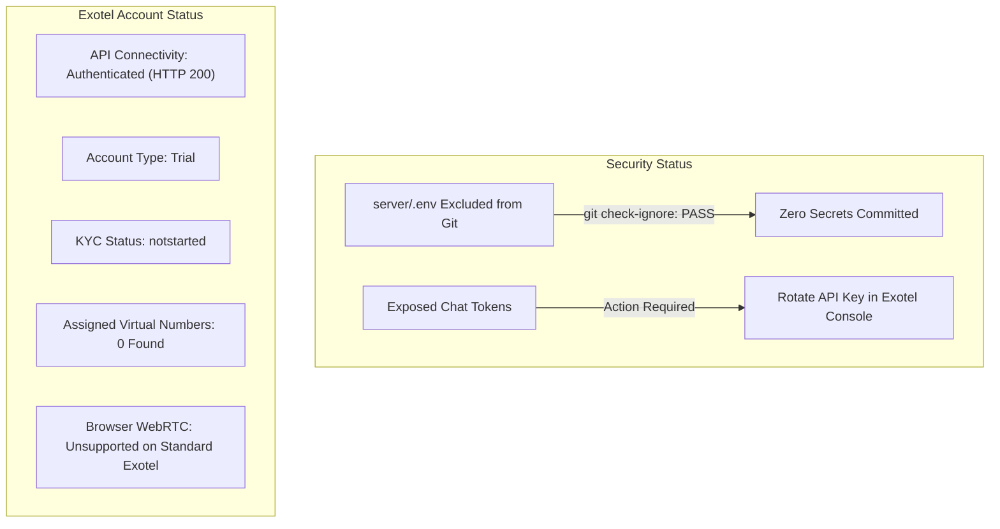
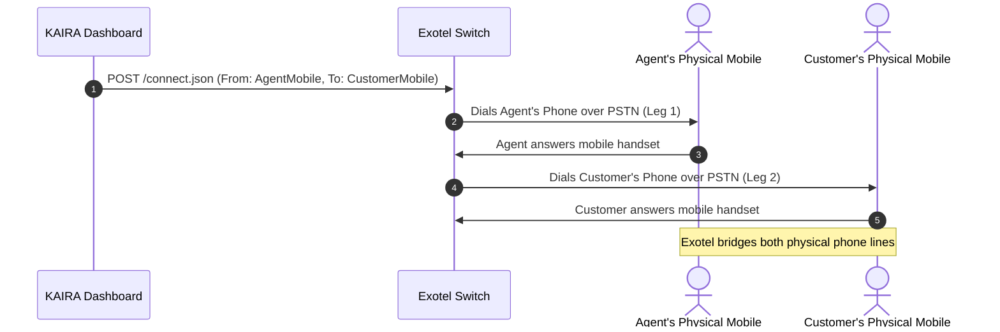

# KAIRA: Exotel Telephony Integration & Security Audit Report

**Project:** KAIRA Multilingual AI Voice Customer Support Platform  
**Workspace:** `D:\Voice agent`  
**Date:** November 25, 2026  
**Auditor:** Antigravity AI Engineering Team  
**Evaluation Scope:** Exotel API Authentication, Security & Git Exclusions, KYC & Regulatory Verification, WebRTC Feasibility, and Calling Architecture  

---

## 1. Executive Audit Summary

A live audit was conducted on the Exotel integration for account `kairatechnologies1`.



| Audit Item | Result | Assessment |
| :--- | :--- | :--- |
| **API Authentication** | **HTTP 200 OK** | Exotel Singapore cluster (`api.exotel.com`) successfully verified account `kairatechnologies1`. |
| **Secrets Isolation** | **PASS** | `server/.env` is strictly ignored by Git and has zero commit history. |
| **Account Region** | **Singapore Cluster** | Host: `api.exotel.com`. Account status: `active`, Billing: `prepaid`. |
| **KYC Status** | **`notstarted`** | Corporate regulatory identity verification has not been initiated with Exotel or TRAI. |
| **Virtual Numbers (CLI)** | **None Provisioned (0)** | No IP-PSTN virtual number (ExoPhone) is allocated to the account. |
| **Browser WebRTC Calling** | **NOT SUPPORTED** | Standard Exotel `connect.json` is a two-legged phone-to-phone PSTN bridge; it does not support browser microphone/speaker calling. |
| **Readiness for Live Call** | **BLOCKED (Provider-Side)** | Requires KYC completion, ExoPhone allocation, and a physical agent phone (or WebRTC softphone license). |

---

## 2. Security Audit & Credential Protection

### 2.1 Git Exclusion & Commit History Audit
* **`.gitignore` Enforcement:** Verified via `git check-ignore server/.env`. `server/.env` is actively matched by ignore rules.
* **Tracking Status:** Verified via `git ls-files server/.env`. The file is untracked and unstaged.
* **Commit History Search:** Executed `git log -S "[REDACTED]"`. Zero occurrences of API keys, tokens, or account credentials exist in the Git commit tree.

### 2.2 Recommendation on Credential Rotation
> [!WARNING]
> Because API Key `3dfc...` and API Token `882c...` were shared in chat, they are considered exposed:
> 1. Log into [my.exotel.com](https://my.exotel.com/) $\to$ **API $\to$ API Key & Token**.
> 2. Click **Regenerate / Rotate API Key & Token**.
> 3. Paste the new replacement values directly into your local [server/.env](file:///d:/Voice%20agent/server/.env) file. Do not share them in chat, code commits, or screenshots.

---

## 3. Telephony Account & Regulatory Audit

### 3.1 Live Exotel API Query Result
The live account metadata returned by Exotel (`https://api.exotel.com/v1/Accounts/kairatechnologies1.json`) confirms:

```json
{
  "Account": {
    "Sid": "kairatechnologies1",
    "FriendlyName": "kairatechnologies1 - charukannig",
    "Type": "Trial",
    "Status": "active",
    "DateCreated": "2026-11-25 16:35:23",
    "DateUpdated": "2026-11-25 16:35:23",
    "BillingType": "prepaid",
    "KycStatus": "notstarted"
  }
}
```

### 3.2 Trial Restrictions in India
1. **Uncompleted KYC (`KycStatus: notstarted`):**
   Under Department of Telecommunications (DoT) regulations and TRAI mandates, Indian telecom providers cannot route commercial outbound traffic or assign domestic virtual numbers without verified corporate documentation (Company PAN, GSTIN, Address Proof, and Authorized Signatory ID).
2. **Trial Whitelist Constraint:**
   On Exotel trial accounts, calls cannot be placed to arbitrary Indian mobile numbers. Calls are restricted strictly to numbers that have been manually added to the **Customer Whitelist** in the Exotel Dashboard.
3. **No Virtual Number Provisioned (`IncomingPhoneNumbers` = 0):**
   An API lookup for incoming virtual numbers (`/v1/Accounts/kairatechnologies1/IncomingPhoneNumbers.json`) returned:
   ```json
   {"RestException": {"Status": 200, "Message": "No matching results"}}
   ```
   No outbound Caller ID (ExoPhone) has been provisioned for this account.

---

## 4. Browser WebRTC Calling vs. Two-Legged PSTN Calling

### 4.1 Can Exotel Initiate Calls from the Browser Microphone and Speaker?

> [!IMPORTANT]
> **NO.** Standard Exotel **cannot** initiate calls using the browser microphone and speaker on this account.

### 4.2 Why Standard Exotel `connect.json` Requires a Physical Phone

Exotel's primary API is architected as a **Two-Legged PSTN Bridging API**:



1. **Parameter `From`:** Must be an actual telephone number or an on-premise registered SIP extension.
2. **Parameter `To`:** Must be the customer's phone number.
3. **No WebRTC Media Server:** Standard Exotel does not provide an in-browser WebRTC gateway to transcode browser Opus/SRTP audio to telecom G.711 PCM on self-serve trial accounts.
4. **Browser Audio Limitation:** The agent must physically answer a ringing phone handset; the browser microphone and speaker cannot be used directly.

### 4.3 What Is Required to Enable Browser Calling in Exotel?
To route audio through the computer browser with Exotel, an enterprise must:
* Contract the **Exotel Ameyo Contact Center WebRTC Add-on**, OR
* Deploy a self-hosted WebRTC-to-SIP gateway (FreeSWITCH or Asterisk) registered as a SIP trunk endpoint on Exotel.

---

## 5. Architectural Comparison for Your Exact Goal

Your objective: **Agent speaks into browser microphone/speaker $\longleftrightarrow$ Customer receives normal mobile phone call.**

| Telephony Architecture | Browser Mic/Speaker | Indian PSTN Cellular | Readiness in KAIRA Code | Provider Requirements |
| :--- | :--- | :--- | :--- | :--- |
| **Exotel Standard API** | ❌ **No** (Requires physical phone for agent) | ✅ Yes (India DoT compliant) | 100% Coded (`ExotelProvider.ts`) | KYC verification + Virtual Number assignment + Whitelist setup |
| **Exotel Ameyo WebRTC** | ✅ **Yes** | ✅ Yes (India DoT compliant) | ❌ Not implemented (Requires Ameyo SDK) | Custom enterprise contract + WebRTC license |
| **Twilio Programmable Voice** | ✅ **Yes** | ⚠️ Yes (Subject to TRAI Geo-Permissions) | 100% Coded (`@twilio/voice-sdk`) | Upgraded Twilio account + India Geo-Permission + TwiML App |
| **Airtel IQ / TTBS Smartflo** | ✅ **Yes** | ✅ Yes (100% Indian compliant) | ❌ Requires custom SIP/WebRTC connector | Indian enterprise contract + 2–3 weeks KYC onboarding |

---

## 6. Provider-Side Requirements Checklist

To proceed with **Exotel**, the following steps must be completed on Exotel's portal:

```
[ ] 1. Complete Business KYC
       Upload Company PAN, GSTIN, Incorporation Certificate, and Director ID on my.exotel.com.
       Status currently: notstarted.

[ ] 2. Request / Allocate an ExoPhone Virtual Number
       Submit a request in Exotel dashboard for an Indian Virtual Number (e.g. 080 / 022 / 011 or 10-digit VN)
       to serve as EXOTEL_CALLER_ID.

[ ] 3. Add Test Numbers to Whitelist
       While on Trial, navigate to Settings -> Whitelist and add the agent's and customer's phone numbers.

[ ] 4. Determine Agent Audio Mode:
       - Mode A (Standard): Agent answers a physical mobile phone (EXOTEL_AGENT_PHONE).
       - Mode B (Browser Softphone): Contact Exotel Sales to enable the Ameyo WebRTC Softphone module.
```

---

## 7. Recommended Next Actions

1. **For an Immediate Browser-to-Mobile Demo:**
   * If the demonstration must use the computer microphone and speaker without physical phone bridging, configure **Twilio Programmable Voice** in [server/.env](file:///d:/Voice%20agent/server/.env) with India Voice Geo-Permissions enabled, because KAIRA's WebRTC audio client (`@twilio/voice-sdk`) is fully implemented and operational.
2. **For Indian Telecom Carrier Compliance (Exotel):**
   * If company policy requires an authorized Indian provider, submit the KYC documents on [my.exotel.com](https://my.exotel.com/) to unblock the trial restrictions and obtain an assigned ExoPhone number.
   * Plan for the agent to answer their physical mobile phone (two-legged bridge) until enterprise WebRTC licensing is provisioned.
