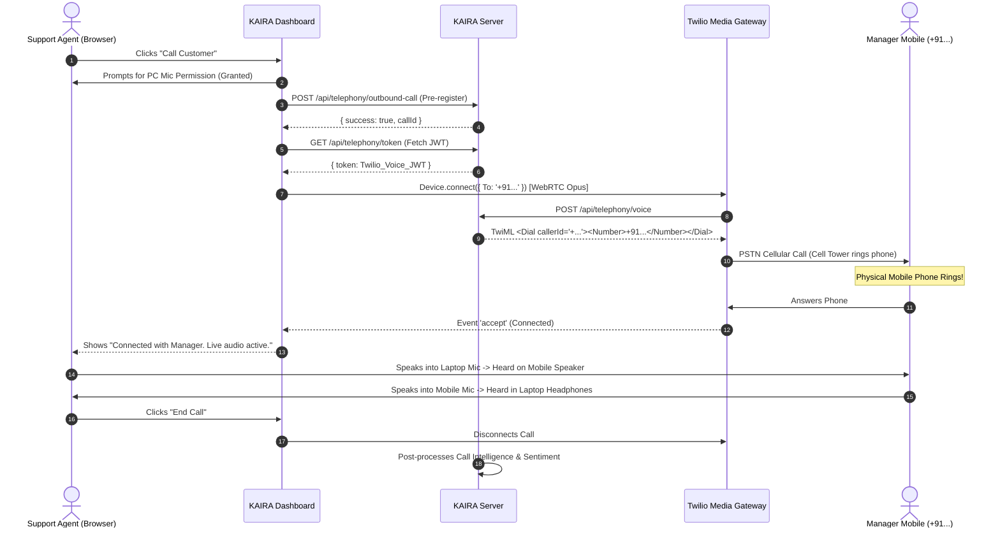

# KAIRA: Real Outbound Mobile Demonstration Preparation Guide

**Project:** KAIRA Multilingual AI Voice Customer Support Platform  
**Workspace:** `D:\Voice agent`  
**Date:** November 25, 2026  
**Objective:** Prepare KAIRA for a real outbound demonstration call to an authorized Indian mobile phone directly from the Agent Dashboard using the browser microphone and speaker.

---

## 1. Ground Truth & Current Status

| Component | Status | Reality Check |
| :--- | :--- | :--- |
| **Current Telephony State** | `Simulation Sandbox` | Running in local demo mode via `MockTelephonyProvider`. All UI elements honestly state that real carrier calling is not yet active. |
| **ElevenLabs TTS** | **Active & Verified** | Human-grade voice synthesis operational with voice `EXAVITQu4vr4xnSDxMaL` ("Sarah") on `eleven_multilingual_v2` (7/7 tests passed). |
| **Deepgram STT** | **Active & Verified** | Streaming WebSocket speech-to-text with auto-punctuation and Indic language support. |
| **Browser WebRTC Calling** | **Fully Implemented in Code** | `@twilio/voice-sdk` is integrated into `client/src/services/telephonyVoice.ts` with device registration, codec selection (Opus/PCMU), and volume/mute/DTMF controls. |
| **Indian PSTN Breakout** | **Pending Carrier Credentials** | Requires authentic telephony provider credentials and configuration to dial an Indian mobile phone. |

> [!IMPORTANT]
> A real telephone call cannot be simulated or mocked. To make an ordinary Indian mobile phone ring over cellular towers (Airtel, Jio, Vi, BSNL), an authentic carrier account with positive balance and authorized outbound permissions is required.

---

## 2. Choosing the Right Provider for Browser-to-Mobile Calling

To achieve the exact objective:
$$\text{Agent Laptop (Browser Mic \& Speaker)} \longleftrightarrow \text{KAIRA WebRTC Bridge} \longleftrightarrow \text{Telephony Gateway} \longleftrightarrow \text{Manager's Ordinary Mobile Phone (PSTN)}$$

Two primary options exist in the industry:

```mermaid
flowchart TD
    subgraph Option A: Twilio Voice WebRTC (Code Already Complete in KAIRA)
        A1[Agent Browser Mic/Speaker] <-->|WebRTC Opus / @twilio/voice-sdk| A2[Twilio Media Gateway]
        A2 <-->|PSTN Dialout via TwiML| A3[Manager's Indian Mobile Phone]
    end

    subgraph Option B: Exotel Two-Legged Phone Bridge
        B1[Agent Physical Mobile / Desk Phone] <-->|PSTN Leg 1| B2[Exotel Cloud Telephony Switch]
        B2 <-->|PSTN Leg 2| B3[Manager's Indian Mobile Phone]
        Note1[Browser Mic is NOT used in standard Exotel]
    end
```

### Evaluation Summary

1. **Option A: Twilio Programmable Voice (Recommended for Browser Calling)**
   - **How it works:** KAIRA's frontend already uses `@twilio/voice-sdk`. The agent speaks directly into their computer microphone, Twilio streams WebRTC audio, and dials the customer's phone via PSTN `<Dial><Number>`.
   - **Code Readiness in KAIRA:** **100% complete**. The client SDK, token generator (`/api/telephony/token`), and TwiML webhook (`/api/telephony/voice`) are written and tested.
   - **Prerequisites:** An upgraded Twilio account with India (`+91`) Voice Geo-Permissions enabled, a TwiML App, and a verified caller ID or purchased phone number.
2. **Option B: Exotel Two-Legged Calling (Alternative if Company Mandates Indian Carrier)**
   - **How it works:** Exotel dials the agent's physical mobile phone first. When the agent answers their physical phone, Exotel dials the customer's mobile phone and bridges the two calls.
   - **Limitation:** Standard Exotel `connect.json` **cannot use the browser microphone/speaker**. To use browser audio on Exotel, an enterprise must buy the Exotel Ameyo Contact Center WebRTC license.

---

## 3. Minimum Requirements to Enable Real Calling via Twilio

If using Twilio to conduct the real browser-to-mobile demonstration call:

### 3.1 Twilio Console Setup (5 Steps)

1. **Account Status:**
   - Account must have a credit balance (e.g., $10–$20) to pay for carrier call termination to India ($\approx \$0.02 - \$0.05/\text{minute}$).
   - *Note for Trial Accounts:* On a Twilio trial account, you **must verify the destination mobile phone** first under **Twilio Console $\to$ Phone Numbers $\to$ Manage $\to$ Verified Caller IDs**.
2. **Enable India Voice Geo-Permissions (CRITICAL):**
   - In Twilio Console, go to **Voice $\to$ Settings $\to$ Geo Permissions**.
   - Search for **India (`+91`)** and ensure the checkbox is **ENABLED**.
   - Accept the high-risk fraud acknowledgment. If this is not enabled, Twilio will reject calls to Indian numbers with error code `21215`.
3. **Provision a Caller ID Number:**
   - Obtain a Twilio phone number (US, UK, or International virtual number), **OR**
   - Add your company phone number / manager's phone as a **Verified Caller ID** in Twilio Console.
4. **Create a TwiML App:**
   - Go to **Voice $\to$ TwiML $\to$ TwiML Apps** and click **Create new TwiML App**.
   - Name: `KAIRA Voice Agent`.
   - **Voice Configuration:**
     - Request URL: `https://<YOUR_PUBLIC_TUNNEL_URL>/api/telephony/voice`
     - HTTP Method: `POST`
     - Status Callback URL: `https://<YOUR_PUBLIC_TUNNEL_URL>/api/telephony/status-callback`
     - HTTP Method: `POST`
   - Copy the generated **TwiML App SID** (starts with `AP...`).
5. **Generate API Key & Secret (Optional but recommended):**
   - In **Account $\to$ API keys & tokens**, generate an API Key SID (`SK...`) and Secret for token minting, or use the Account SID and Auth Token.

---

## 4. Exact Environment File Configuration

When ready to test with authentic credentials, update [server/.env](file:///d:/Voice%20agent/server/.env) with the following parameters:

```env
# 1. Switch Provider to Twilio
TELEPHONY_PROVIDER=twilio

# 2. Twilio Account Identification
TWILIO_ACCOUNT_SID=ACxxxxxxxxxxxxxxxxxxxxxxxxxxxxxxxx
TWILIO_AUTH_TOKEN=xxxxxxxxxxxxxxxxxxxxxxxxxxxxxxxx

# 3. TwiML App SID (Created in Section 3.1 Step 4)
TWILIO_TWIML_APP_SID=APxxxxxxxxxxxxxxxxxxxxxxxxxxxxxxxx

# 4. Outbound Caller ID (Your Twilio Number or Verified Caller ID, E.164 format)
TWILIO_CALLER_ID=+12025550199

# 5. Public Webhook Tunnel URL (Cloudflare Tunnel or ngrok)
WEBHOOK_URL=https://version-intelligent-eclipse-cleanup.trycloudflare.com

# 6. Safety Allowlist
# Either ensure your manager's number is in AUTHORIZED_TEST_NUMBERS or set to false:
TELEPHONY_ENFORCE_ALLOWLIST=false
```

> [!CAUTION]
> Never commit `server/.env` to Git. It is already protected in `.gitignore`.

---

## 5. End-to-End Call Verification Protocol

To verify that the demonstration call is genuine:



### Verification Checklist:
1. **Physical Ring:** The manager's phone rings with an incoming cellular call.
2. **Caller ID Match:** The incoming call display matches the configured `TWILIO_CALLER_ID`.
3. **Audio Clarity:** The manager hears the agent's voice speaking from the browser with no echo.
4. **Agent Audio:** The agent hears the manager's voice clearly in their computer headset.
5. **Call Log Persistence:** Once terminated, KAIRA automatically records the call duration, updates call history, and processes post-call intelligence.

---

## 6. Pre-Call Verification Test Commands

To verify that the platform's speech and telephony engines are functioning before placing a live call:

```bash
# 1. Verify ElevenLabs Natural Voice Synthesis (7/7 tests)
npx --prefix server tsx server/src/scripts/test_elevenlabs_integration.ts

# 2. Verify Telephony Logic, E.164 Formatting, and State Machine (25/25 tests)
npx --prefix server tsx server/src/scripts/test_outbound_telephony_suite.ts

# 3. Verify Client and Backend Builds
npm --prefix server run build
npm --prefix client run build && npm --prefix client run lint
```
